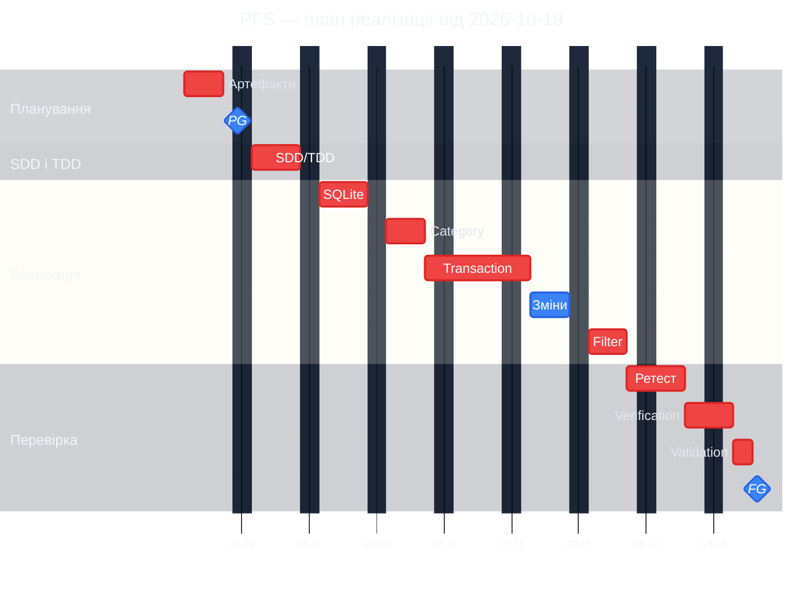

# Поетапний план реалізації Personal Finance System

**Статус:** APPROVED  
**Дата перевірки та затвердження:** 2026-10-16  
**Рішення прийняла:** студентка після ручної перевірки  
**Орієнтовний початок:** 2026-10-19  
**Орієнтовне завершення:** 2026-12-17  
**Планова тривалість:** 44 робочі дні  
**Умова початку систематичної реалізації:** окреме рішення `GO` студентки на PLAN-GATE `T-025` / [#3](https://github.com/01ena-shpak/personal-finance-system/issues/3)

## 1. Основа планування

План побудовано за затвердженою SRS, затвердженим `spec/addendum.md`, погодженою декомпозицією `T-001`–`T-025`, матрицею простежуваності та фактичними GitHub Issues `#1`–`#25`.

На момент складання плану:

- `T-001` / #1 і `T-002` / #2 завершені та закриті після затвердження Addendum;
- `T-003`–`T-025`, крім уже завершених `T-001` і `T-002`, залишаються запланованими;
- PLAN-GATE `T-025` / #3 відкритий, рішення `GO` або `REVISE` не прийняте;
- реалізація Android-застосунку на Python/Flet і SQLite ще не розпочата;
- оцінки припускають п’ятиденний робочий тиждень без роботи у вихідні, один основний потік студентського проєкту та співпрацю студентки з Codex;
- дати після PLAN-GATE є умовними: вони справджуються лише за рішення `GO` не пізніше 2026-10-23. Рішення `REVISE` або відкладене рішення зсуває весь наступний графік.

## 2. Підхід SDD і TDD

SDD застосовується перед реалізацією кожного інкременту: спочатку уточнюються межі компонента, модель даних, взаємодії Flet UI, SQLite та правила обробки помилок, після чого рішення звіряються із SRS і Addendum.

TDD застосовується у дві фази в межах `T-016`–`T-019`:

1. До відповідних Feature готуються й перевіряються тестові випадки та очікувані результати. Ця контрольна точка розблоковує реалізацію.
2. Після реалізації тести виконуються повторно; Test-тікет закривається лише після успішного прогону або документування відхилень.

Verification `T-020`–`T-022` виконується лише на готовій інтегрованій реалізації. Validation `T-023` виконує студентка після Feature, повторних Test і Verification. Така послідовність не створює циклічних залежностей.

## 3. Етапи, тривалість і календар

| № | Основний етап | Зміст і пов’язані тікети | Тривалість, роб. дні | Початок | Завершення | Залежності / умова завершення |
|---|---|---|---:|---|---|---|
| 1 | Підготовка планових артефактів | Контроль повноти декомпозиції й матриці; підготовка цього календарного плану; підготовка реєстру ризиків | 4 | 2026-10-19 | 2026-10-22 | Затверджені SRS та Addendum, завершені `T-001/#1`, `T-002/#2`; реєстр ризиків підготовлено й перевірено до PLAN-GATE |
| 2 | PLAN-GATE | Перевірка декомпозиції, залежностей, оновленої матриці простежуваності, календарного плану та реєстру ризиків; `T-025/#3` | 1 | 2026-10-23 | 2026-10-23 | Рішення ухвалює лише студентка; план не припускає, що `GO` уже надано |
| 3 | SDD і підготовка тестів | Архітектурні рішення в межах Addendum, модель даних SQLite, межі шарів, навігація Flet; перша фаза `T-016/#4`–`T-019/#7` | 5 | 2026-10-26 | 2026-10-30 | Лише після `GO`; тестові випадки перевірені до початку відповідних Feature |
| 4 | Базові й наскрізні механізми | SQLite і транзакційність `T-009/#8`, безпечний текст `T-014/#9`, повідомлення валідації `T-015/#10` | 5 | 2026-11-02 | 2026-11-06 | Етап 3; відповідні тестові контрольні точки `T-016`–`T-018` готові |
| 5 | Інкремент Category | Створення та список `T-003/#11`, перейменування `T-004/#12`; частина захисту видалення, яка не потребує Transaction | 4 | 2026-11-09 | 2026-11-12 | Етап 4 і підготовка `T-016/#4` |
| 6 | Ядро Transaction | Створення й валідація `T-006/#13`, базова інтеграція з Category і SQLite, Transaction List `T-010/#15`, фінансові показники `T-013/#17` | 7 | 2026-11-13 | 2026-11-23 | Етап 5; підготовка `T-017/#5`–`T-019/#7` |
| 7 | Операції зміни та залежності | Редагування `T-007/#16`, видалення Transaction `T-008/#18`, завершення захищеного видалення Category `T-005/#14` | 4 | 2026-11-24 | 2026-11-27 | Готові `T-006`, `T-010`, `T-013`; для `T-005` існує зв’язок Category–Transaction |
| 8 | Filter і порожні стани | Комбіновані Filter `T-011/#19`, порожні стани `T-012/#20`, інтеграція з незмінними глобальними показниками | 4 | 2026-11-30 | 2026-12-03 | Готовий Transaction List і підготовка `T-018/#6` |
| 9 | Повторне виконання Test та стабілізація | Повний повторний прогін `T-016/#4`–`T-019/#7`, виправлення в межах затверджених вимог, інтеграційна стабілізація Android/Flet/SQLite | 4 | 2026-12-04 | 2026-12-09 | Усі Feature `T-003`–`T-015` завершені; Test закриваються лише після повторного прогону |
| 10 | Verification | Постійність і цілісність SQLite `T-020/#21`, безпечне текстове введення `T-021/#22`, термінологія `T-022/#23` | 3 | 2026-12-10 | 2026-12-14 | Готова інтегрована реалізація та завершені повторні Test |
| 11 | Validation задуму | Наскрізне виконання `BDD-001`–`BDD-016`, оцінка відповідності потребам User; `T-023/#24` | 2 | 2026-12-15 | 2026-12-16 | Успішні Feature, Test і Verification; виконує та приймає студентка |
| 12 | Завершальний Gate | Перевірка реалізації, доказів, трасування та невирішених відхилень; `T-024/#25` | 1 | 2026-12-17 | 2026-12-17 | Після Validation; рішення ухвалює лише студентка |

Оцінка 44 робочі дні є календарною тривалістю основного потоку, а не сумою людино-днів. Робота Codex і перевірки студентки можуть частково перекриватися, але контрольні точки студентки залишаються блокувальними.

## 4. Діаграма Ганта

`PG` означає PLAN-GATE, а `FG` — завершальний Gate. Обидві контрольні точки показано як Mermaid `milestone`; одноденна тривалість їх підготовки та перевірки залишається зафіксованою в таблиці плану. Помаранчевий колір milestone задано через підтримуваний `themeCSS`; він не позначає статус виконання або прийняте Gate-рішення.

Mermaid показує ресурсно реалістичний основний потік. Усередині етапів окремі підзадачі можуть виконуватися паралельно, але це не використано для штучного скорочення календарної оцінки.

## 5. Критичний шлях

Для одного основного потоку критичний шлях становить 44 робочі дні:

`планові артефакти та реєстр ризиків` → `T-025 PLAN-GATE` → `SDD + підготовка T-016–T-019` → `T-009/T-014/T-015` → `T-003` → `T-006` → `T-010` → `T-011` → `T-012` → `повторне виконання T-016–T-019` → `T-020–T-022` → `T-023` → `T-024`.

Гілки `T-004`, `T-005`, `T-007`, `T-008` і `T-013` мають бути завершені до інтеграційного повторного прогону. У суто мережевій моделі частина з них має невеликий резерв, але в студентському проєкті вони використовують той самий обмежений ресурс і фактично можуть перейти на критичний шлях.

Безпосередньо зміщують завершення:

- затримка реєстру ризиків, календарного плану, матриці або рішення PLAN-GATE;
- повернення `REVISE`, оскільки вся систематична реалізація заблокована до майбутнього `GO`;
- затримка підготовки чи перевірки тестів `T-016`–`T-019`, бо Feature не повинні починатися без відповідної TDD-контрольної точки;
- проблеми інтеграції Flet на Android або транзакцій SQLite в базовому етапі;
- затримка `T-003`, `T-006`, `T-010`, `T-011` чи `T-012`, які утворюють найдовший функціональний ланцюг;
- невиправлені дефекти повторного прогону, Verification або Validation;
- недоступність студентки для PLAN-GATE, переглядів тестів, Validation чи завершального Gate.

## 6. Оцінка дій студентки

| Дія студентки | Активна тривалість, роб. дні | Орієнтовне вікно | Вплив на календар |
|---|---:|---|---|
| Контроль вимог, Addendum, декомпозиції та матриці | 0,5 | 2026-10-19 | Блокує завершення підготовки до PLAN-GATE, якщо знайдено розбіжності |
| Перевірка календарного плану та реєстру ризиків | 1,0 | 2026-10-21–2026-10-22 | Обов’язкова передумова PLAN-GATE |
| Ухвалення рішення PLAN-GATE | 0,5 | 2026-10-23 | Повністю блокує систематичну реалізацію до окремого `GO`; поточний план не є `GO` |
| Перевірка SDD і підготовлених тестів | 1,5 | 2026-10-26–2026-10-30 | Затримка переносить старт відповідних Feature |
| Перегляд результатів Codex після основних інкрементів | 3,0 сумарно | 2026-11-02–2026-12-09 | Орієнтовно по 0,5 дня на шість контрольних переглядів; зауваження можуть повертати етап на доопрацювання |
| Перевірка результатів Test і Verification | 1,0 | 2026-12-09–2026-12-14 | Блокує Validation за відсутності достатніх доказів |
| Валідація задуму та BDD | 2,0 | 2026-12-15–2026-12-16 | Повністю входить у критичний шлях |
| Ухвалення завершального Gate-рішення | 0,5 | 2026-12-17 | Визначає завершення проєкту |
| **Разом активної участі студентки** | **10,0** | Упродовж плану | Частково перекривається з роботою Codex, але очікування відповіді понад заплановане зсуває контрольні точки |

Оцінка не включає непередбачений час очікування між передаванням результату Codex і початком перегляду студенткою. Для збереження дат бажано резервувати перевірки заздалегідь; кожен додатковий робочий день очікування на блокувальній контрольній точці переносить завершення щонайменше на один робочий день.

## 7. Планові ризики та резерв

До PLAN-GATE має бути створений і перевірений окремий реєстр ризиків. Мінімально він повинен охопити:

- сумісність Python/Flet зі збиранням і запуском Android-застосунку;
- доступність і поведінку локального SQLite через `sqlite3` у цільовому пакуванні;
- коректність транзакцій, rollback і роботи з нечитабельною тестовою базою;
- обмежений час студентки на перевірки та Gate-рішення;
- ризик повторної роботи через недостатньо перевірений SDD або тести;
- інтеграційні дефекти мобільного UI, локального сховища й доменних правил;
- збереження повного трасування `REQ → AC → BDD → Issue → Test → Code → Documentation`.

У базові 44 робочі дні включено час на звичайну стабілізацію, але не окремий управлінський резерв для суттєвих ризиків. Для зовнішньої обіцянки строку доцільно додати 5 робочих днів резерву; тоді консервативна дата завершення — 2026-12-24. Розмір резерву та спосіб його відображення має перевірити студентка до PLAN-GATE.

## 8. Що запропонував Codex і що перевіряє студентка

Codex запропонував:

- 12 основних етапів і їх групування за Issues;
- оцінки тривалості, календарні дати та базову тривалість 44 робочі дні;
- ресурсно обмежений критичний шлях;
- 10 робочих днів активної участі студентки, розподілених по контрольних точках;
- перелік ризиків для майбутнього реєстру та рекомендацію резерву 5 робочих днів.

Студентка повинна перевірити й окремо погодити:

- реалістичність тривалостей з урахуванням власного навчального графіка;
- доступність у вікнах перевірки тестів, Validation і Gate;
- склад та оцінки реєстру ризиків;
- прийнятність базової дати 2026-12-17 і резервної дати 2026-12-24;
- коректність критичного шляху й допустимий паралелізм;
- готовність матриці, плану та реєстру ризиків до PLAN-GATE;
- саме рішення `GO` або `REVISE` на `T-025`, яке цим документом не приймається.

## 9. Підсумок

За умови майбутнього `GO` 2026-10-23 і відсутності суттєвих відхилень орієнтовна тривалість становить **44 робочі дні**, від 2026-10-19 до 2026-12-17. Із рекомендованим п’ятиденним резервом зовнішній орієнтир становить **49 робочих днів** із завершенням 2026-12-24.

Найбільші загрози плану — затримка PLAN-GATE або перевірок студентки, проблеми Android/Flet/SQLite, неповна підготовка TDD-тестів і дефекти, знайдені під час інтеграційного повторного прогону чи Validation.
