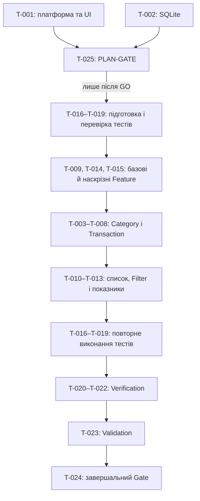

# Декомпозиція SRS на тікети

Статус документа: оновлена декомпозиція після ручної перевірки. Декомпозиція ґрунтується на затвердженій SRS, пов’язаних артефактах і затвердженому 2026-10-16 `spec/addendum.md`; вона не змінює baseline базової SRS. Наведені нижче залежності та відповідальні ролі перевірені й погоджені студенткою з уточненням критеріїв PLAN-GATE.

| Тимчасовий ID | Назва | Тип | Короткий опис | Пов’язані вимоги | Очікуваний результат |
|---|---|---|---|---|---|
| T-001 | Зафіксувати платформу та мобільний інтерфейс | Addendum | Зафіксувати затверджене рішення про Android-застосунок на Python/Flet з українським графічним інтерфейсом; описати вибір Transaction натисканням на запис, редагування/видалення без показу Transaction ID та розрізнення однойменних Category за типом із використанням внутрішнього Category ID. | `REQ-F-007`, `REQ-F-008`, `REQ-F-009`, `REQ-F-010`, `REQ-F-011`, `REQ-F-012`, `REQ-F-013`, `REQ-F-014`, `REQ-F-015`, `REQ-F-017`, `REQ-NF-005`, `REQ-NF-006` | Затверджений addendum точно фіксує рішення щодо платформи й взаємодії без додавання нової функціональності. |
| T-002 | Зафіксувати локальне зберігання SQLite | Addendum | Зафіксувати затверджене рішення про локальну SQLite через Python `sqlite3`, без сервера й інтернету; визначити застосування транзакцій SQLite, контрольованої помилки до їх завершення та окремої тестової бази для нечитабельних даних. | `REQ-F-001`, `REQ-NF-001`, `REQ-NF-002`, `REQ-NF-003` | Затверджений addendum конкретизує механізм зберігання й спосіб перевірки цілісності без зміни вимог. |
| T-025 | Провести PLAN-GATE декомпозиції | Gate | До початку систематичної реалізації перевірити повноту декомпозиції, відповідність затвердженій SRS, логічність залежностей, оновлену матрицю простежуваності, календарний план і реєстр ризиків із контролем суттєвих ризиків. Рішення `GO` або `REVISE` приймає лише студентка; наразі рішення не прийняте. | `REQ-F-001`–`REQ-F-024`, `REQ-NF-001`–`REQ-NF-006` | Рішення `GO` можливе лише після успішної перевірки всіх перелічених планових артефактів; систематична реалізація починається лише після `GO`, а для `REVISE` визначаються необхідні коригування плану. |
| T-003 | Реалізувати створення та список Category | Feature | Додати створення Category з унікальним незмінним внутрішнім Category ID, валідацією типу й назви, а також перегляд усіх Category з назвою і типом; однойменні Category різних типів розрізняти за типом. | `REQ-F-010`, `REQ-F-011`, `REQ-F-012`, `REQ-NF-005` | Коректна Category зберігається та відображається у списку; однойменні Category різних типів однозначно розрізняються, а некоректні значення відхиляються з повідомленням про поле і правило. |
| T-004 | Реалізувати перейменування Category | Feature | Додати перейменування Category із застосуванням до нової назви правил, прямо визначених для створення Category у `REQ-F-011`, без зміни Category ID. | `REQ-F-011`, `REQ-F-013`, `REQ-NF-005` | Нова назва, що відповідає `REQ-F-011`, відображається у списку й пов’язаних Transaction; назва, що порушує ці правила, відхиляється зі збереженням попередньої. |
| T-005 | Реалізувати безпечне видалення Category | Feature | Дозволити видалення лише Category без пов’язаних Transaction і відхиляти видалення використаної Category. | `REQ-F-014` | Вільна Category видаляється; використана Category та пов’язані з нею Transaction залишаються без змін. |
| T-006 | Реалізувати створення Transaction та валідацію полів | Feature | Додати створення Transaction з незмінним унікальним ID і правилами для type, amount, date, category та необов’язкового description. | `REQ-F-002`, `REQ-F-003`, `REQ-F-004`, `REQ-F-005`, `REQ-F-006`, `REQ-F-007`, `REQ-NF-005` | Коректна Transaction зберігається; кожна некоректна комбінація відхиляється із зазначенням поля та порушеного правила. |
| T-007 | Реалізувати редагування Transaction | Feature | Додати вибір Transaction натисканням на запис у мобільному списку та зміну її даних із повторним застосуванням усіх правил створення, використовуючи внутрішній Transaction ID без його показу. | `REQ-F-004`, `REQ-F-005`, `REQ-F-006`, `REQ-F-007`, `REQ-F-008`, `REQ-F-015`, `REQ-NF-005` | Коректні зміни зберігаються без зміни й показу ID; некоректні відхиляються без втрати останнього коректного стану. |
| T-008 | Реалізувати остаточне видалення Transaction | Feature | Додати вибір Transaction натисканням на запис і її остаточне видалення за внутрішнім Transaction ID з виключенням із Transaction List і фінансових показників. | `REQ-F-009`, `REQ-F-015`, `REQ-F-021`, `REQ-F-022`, `REQ-F-023` | Вибрана й видалена Transaction відсутня у списку та більше не впливає на показники; внутрішній ID не показується. |
| T-009 | Реалізувати надійне постійне зберігання у SQLite | Feature | Забезпечити локальне зберігання Transaction і Category через `sqlite3`, відновлення між штатними запусками, атомарність операцій SQLite та незмінність нечитабельних збережених даних. | `REQ-F-001`, `REQ-NF-001`, `REQ-NF-002`, `REQ-NF-003` | Після успішної операції стан відновлюється при перезапуску; rollback не залишає часткових змін, а помилка читання повідомляється без перезапису даних. |
| T-010 | Реалізувати Transaction List, формат сум і порядок записів | Feature | Відобразити погоджені поля Transaction без Transaction ID, суми в UAH із двома десятковими знаками та типовий порядок за датою від новіших записів до старіших. | `REQ-F-002`, `REQ-F-015`, `REQ-F-016` | Список має визначений склад полів і формат сум; записи з різними датами впорядковані від новіших до старіших. |
| T-011 | Реалізувати комбіновану фільтрацію Transaction List | Feature | Додати Filter за Transaction Type, Category і включним Date Range окремо та разом; для Category використовувати внутрішній ID і показувати тип для розрізнення однакових назв; некоректний Date Range не застосовувати й пояснювати повідомленням. | `REQ-F-011`, `REQ-F-017`, `REQ-F-018` | Список містить лише записи, що відповідають усім активним умовам; однойменні Category різних типів однозначно розрізняються, межі діапазону включені, а некоректний діапазон не змінює список. |
| T-012 | Реалізувати порожні стани Transaction List | Feature | Розрізнити відсутність збережених Transaction і відсутність збігів після фільтрації та показувати відповідні інформаційні повідомлення. | `REQ-F-019`, `REQ-F-020` | В обох випадках показано порожній список і повідомлення, що відповідає причині порожнього стану. |
| T-013 | Реалізувати фінансові показники | Feature | Обчислювати Total Income, Total Expenses і Current Balance за всіма збереженими Transaction незалежно від активних Filter. | `REQ-F-021`, `REQ-F-022`, `REQ-F-023`, `REQ-F-024` | Показники мають правильні значення, Current Balance може бути від’ємним, а фільтрація списку їх не змінює. |
| T-014 | Забезпечити безпечну обробку текстових значень | Feature | Обробляти Category Name і Description лише як дані під час введення, збереження та відображення. | `REQ-NF-004` | Текст із синтаксисом команд або коду зберігається й відображається як звичайний текст та не виконується. |
| T-015 | Уніфікувати повідомлення валідації | Feature | Для всіх правил введення забезпечити повідомлення, яке однозначно називає помилкове поле та пояснює порушене правило. | `REQ-F-004`, `REQ-F-005`, `REQ-F-006`, `REQ-F-007`, `REQ-F-011`, `REQ-F-013`, `REQ-F-018`, `REQ-NF-005` | Кожна відмова через введення супроводжується однозначним повідомленням про поле і правило. |
| T-016 | Перевірити життєвий цикл Category | Test | До реалізації відповідних Feature підготувати автоматизовані перевірки створення, правил назви, списку, перейменування та обмеження видалення Category; після реалізації повторно виконати їх. | `REQ-F-010`, `REQ-F-011`, `REQ-F-012`, `REQ-F-013`, `REQ-F-014`, `REQ-NF-005` | Підготовлені перевірки після повторного виконання на реалізації підтверджують `AC-010`–`AC-015` і релевантну частину `AC-030`. |
| T-017 | Перевірити життєвий цикл і валідацію Transaction | Test | До реалізації відповідних Feature підготувати перевірки створення, усіх меж валідації, редагування зі сталим ID та остаточного видалення Transaction; після реалізації повторно виконати їх. | `REQ-F-002`, `REQ-F-003`, `REQ-F-004`, `REQ-F-005`, `REQ-F-006`, `REQ-F-007`, `REQ-F-008`, `REQ-F-009`, `REQ-NF-005` | Підготовлені перевірки після повторного виконання на реалізації підтверджують `AC-002`–`AC-009` і релевантну частину `AC-030`. |
| T-018 | Перевірити Transaction List і Filter | Test | До реалізації відповідних Feature підготувати перевірки складу полів, приховування ID, порядку дат, окремих і комбінованих Filter, включних меж, некоректного Date Range та порожніх станів; після реалізації повторно виконати їх. | `REQ-F-015`, `REQ-F-016`, `REQ-F-017`, `REQ-F-018`, `REQ-F-019`, `REQ-F-020` | Підготовлені перевірки після повторного виконання на реалізації підтверджують `AC-016`–`AC-021`. |
| T-019 | Перевірити фінансові показники | Test | До реалізації відповідного Feature підготувати перевірки підсумків за типами, додатного й від’ємного Current Balance та незалежності показників від Filter; після реалізації повторно виконати їх. | `REQ-F-021`, `REQ-F-022`, `REQ-F-023`, `REQ-F-024` | Підготовлені перевірки після повторного виконання на реалізації підтверджують `AC-022`–`AC-025`. |
| T-020 | Перевірити постійність і цілісність даних SQLite | Verification | На готовій реалізації перевірити відновлення успішних змін після перезапуску; контрольовано спричинити помилку до успішного завершення транзакції SQLite; поведінку з нечитабельними даними перевірити лише на окремій тестовій базі. | `REQ-F-001`, `REQ-NF-001`, `REQ-NF-002`, `REQ-NF-003` | Докази підтверджують `AC-001`, `AC-026`, `AC-027` і `AC-028`: незавершені зміни скасовані, попередній коректний стан збережений, а перевірка помилки читання не зачіпає справжніх даних User. |
| T-021 | Перевірити невиконання текстового введення | Verification | Перевірити текстові поля на прикладах допустимої довжини із синтаксисом команд і програмного коду. | `REQ-NF-004` | Зафіксовані докази підтверджують `AC-029`: введені значення не виконуються. |
| T-022 | Перевірити термінологію інтерфейсу за глосарієм | Verification | Переглянути всі частини реалізованого інтерфейсу та звірити назви понять, дій і показників із глосарієм. | `REQ-NF-006` | Перевірка підтверджує `AC-031`; різні назви одного поняття або дії відсутні. |
| T-023 | Провести наскрізну валідацію за BDD-сценаріями | Validation | Виконати затверджені `BDD-001`–`BDD-016` на інтегрованій системі та задокументувати результати без зміни самих сценаріїв. | `REQ-F-001`–`REQ-F-024`, `REQ-NF-001`–`REQ-NF-005` | Усі 16 BDD-сценаріїв мають зафіксований результат; відхилення пов’язані з відповідними REQ та AC. |
| T-024 | Провести завершальний gate реалізації вимог | Gate | Після реалізації, тестування та валідації перевірити результати Feature, Test, Verification і Validation, а також заповнення зв’язків Ticket/Test/Code/Documentation у матриці простежуваності. Цей gate не замінює PLAN-GATE `T-025`. | `REQ-F-001`–`REQ-F-024`, `REQ-NF-001`–`REQ-NF-006` | Для кожної вимоги наявні докази реалізації та перевірки; зафіксовано завершальне рішення і перелік невирішених відхилень, якщо вони є. |

## Відповідність T-ID і GitHub Issues

| T-ID | GitHub Issue | Стан у Project №2 |
|---|---|---|
| `T-001` | [#1](https://github.com/01ena-shpak/personal-finance-system/issues/1) | Done |
| `T-002` | [#2](https://github.com/01ena-shpak/personal-finance-system/issues/2) | Done |
| `T-003` | [#11](https://github.com/01ena-shpak/personal-finance-system/issues/11) | Todo |
| `T-004` | [#12](https://github.com/01ena-shpak/personal-finance-system/issues/12) | Todo |
| `T-005` | [#14](https://github.com/01ena-shpak/personal-finance-system/issues/14) | Todo |
| `T-006` | [#13](https://github.com/01ena-shpak/personal-finance-system/issues/13) | Todo |
| `T-007` | [#16](https://github.com/01ena-shpak/personal-finance-system/issues/16) | Todo |
| `T-008` | [#18](https://github.com/01ena-shpak/personal-finance-system/issues/18) | Todo |
| `T-009` | [#8](https://github.com/01ena-shpak/personal-finance-system/issues/8) | Todo |
| `T-010` | [#15](https://github.com/01ena-shpak/personal-finance-system/issues/15) | Todo |
| `T-011` | [#19](https://github.com/01ena-shpak/personal-finance-system/issues/19) | Todo |
| `T-012` | [#20](https://github.com/01ena-shpak/personal-finance-system/issues/20) | Todo |
| `T-013` | [#17](https://github.com/01ena-shpak/personal-finance-system/issues/17) | Todo |
| `T-014` | [#9](https://github.com/01ena-shpak/personal-finance-system/issues/9) | Todo |
| `T-015` | [#10](https://github.com/01ena-shpak/personal-finance-system/issues/10) | Todo |
| `T-016` | [#4](https://github.com/01ena-shpak/personal-finance-system/issues/4) | Todo |
| `T-017` | [#5](https://github.com/01ena-shpak/personal-finance-system/issues/5) | Todo |
| `T-018` | [#6](https://github.com/01ena-shpak/personal-finance-system/issues/6) | Todo |
| `T-019` | [#7](https://github.com/01ena-shpak/personal-finance-system/issues/7) | Todo |
| `T-020` | [#21](https://github.com/01ena-shpak/personal-finance-system/issues/21) | Todo |
| `T-021` | [#22](https://github.com/01ena-shpak/personal-finance-system/issues/22) | Todo |
| `T-022` | [#23](https://github.com/01ena-shpak/personal-finance-system/issues/23) | Todo |
| `T-023` | [#24](https://github.com/01ena-shpak/personal-finance-system/issues/24) | Todo |
| `T-024` | [#25](https://github.com/01ena-shpak/personal-finance-system/issues/25) | Todo |
| `T-025` | [#3](https://github.com/01ena-shpak/personal-finance-system/issues/3) | Todo; рішення `GO/REVISE` не прийняте |

## Логічні залежності та контрольні точки

### Погоджені залежності й відповідальні ролі

У таблиці залежність означає передумову початку тікета, якщо окремо не вказано контрольну точку Test. Для `T-016`–`T-019` застосовується двоетапний життєвий цикл: підготовлені тести спочатку перевіряються як контрольна точка й розблоковують відповідні Feature; сам Test-тікет залишається відкритим до повторного виконання цих тестів після реалізації. Завдяки цьому TDD не створює циклу «Test залежить від Feature, а Feature — від завершеного Test».

| Тікет | Залежить від | Чому | Запропонована відповідальна роль |
|---|---|---|---|
| `T-001` | Немає | Вихідне рішення щодо платформи та взаємодії; затверджене студенткою в addendum. | Student + Codex |
| `T-002` | Немає | Вихідне рішення щодо SQLite та перевірки цілісності; затверджене студенткою в addendum. | Student + Codex |
| `T-003` | `T-025` (`GO`), контрольна точка підготовки `T-016`, `T-009`, `T-014`, `T-015` | Реалізація Category починається після PLAN-GATE, перевірених тестів і готових наскрізних механізмів зберігання, безпечного тексту та повідомлень. | Codex |
| `T-004` | `T-003`, контрольна точка підготовки `T-016` | Перейменування потребує наявної Category та заздалегідь перевірених тестів правил назви. | Codex |
| `T-005` | `T-003`, `T-006`, контрольна точка підготовки `T-016` | Обмеження видалення перевіряє зв’язок Category з уже реалізованою Transaction. | Codex |
| `T-006` | `T-025` (`GO`), контрольна точка підготовки `T-017`, `T-003`, `T-009`, `T-014`, `T-015` | Transaction потребує Category, сховища, безпечної обробки тексту, повідомлень і перевірених до реалізації тестів. | Codex |
| `T-007` | `T-006`, `T-010`, контрольна точка підготовки `T-017` | Редагування потребує створеної Transaction, вибору запису зі списку та підготовлених тестів. | Codex |
| `T-008` | `T-006`, `T-010`, `T-013`, контрольна точка підготовки `T-017` | Видалення потребує Transaction, вибору зі списку та показників, з яких запис має бути виключений. | Codex |
| `T-009` | `T-025` (`GO`), контрольні точки підготовки `T-016`, `T-017` | SQLite є базовим механізмом для життєвих циклів Category і Transaction; відповідні перевірки готуються до реалізації. | Codex |
| `T-010` | `T-006`, контрольна точка підготовки `T-018` | Список відображає вже створені Transaction за попередньо визначеними перевірками. | Codex |
| `T-011` | `T-010`, контрольна точка підготовки `T-018` | Filter застосовується до готового Transaction List і перевіряється підготовленими тестами. | Codex |
| `T-012` | `T-010`, `T-011`, контрольна точка підготовки `T-018` | Порожні стани залежать від базового списку та результатів Filter. | Codex |
| `T-013` | `T-006`, контрольна точка підготовки `T-019` | Показники обчислюються за збереженими Transaction відповідно до заздалегідь підготовлених тестів. | Codex |
| `T-014` | `T-025` (`GO`), контрольні точки підготовки `T-016`, `T-017` | Безпечна обробка тексту є наскрізною передумовою для текстових полів Category і Transaction. | Codex |
| `T-015` | `T-025` (`GO`), контрольні точки підготовки `T-016`, `T-017`, `T-018` | Узгоджені повідомлення потрібні до реалізації сценаріїв валідації Category, Transaction і Date Range. | Codex |
| `T-016` | `T-025` (`GO`) | Після PLAN-GATE готуються й перевіряються тести Category; тікет закривається після їх повторного виконання для `T-003`–`T-005`, `T-014`, `T-015`. | Codex |
| `T-017` | `T-025` (`GO`) | Після PLAN-GATE готуються й перевіряються тести Transaction; тікет закривається після їх повторного виконання для `T-006`–`T-009`, `T-014`, `T-015`. | Codex |
| `T-018` | `T-025` (`GO`) | Після PLAN-GATE готуються й перевіряються тести списку та Filter; тікет закривається після їх повторного виконання для `T-010`–`T-012`, `T-015`. | Codex |
| `T-019` | `T-025` (`GO`) | Після PLAN-GATE готуються й перевіряються тести показників; тікет закривається після їх повторного виконання для `T-013`. | Codex |
| `T-020` | `T-003`–`T-009`, завершені повторні виконання `T-016`, `T-017` | Постійність та атомарність перевіряються на готових операціях зміни даних і сховищі. | Student + Codex |
| `T-021` | `T-003`, `T-004`, `T-006`, `T-007`, `T-010`, `T-014`, завершені повторні виконання `T-016`, `T-017` | Невиконання введення перевіряється на готових текстових полях, збереженні та відображенні. | Student + Codex |
| `T-022` | `T-003`–`T-008`, `T-010`–`T-015`, завершені повторні виконання `T-016`–`T-019` | Термінологію можна повністю звірити лише в готовому інтерфейсі. | Student + Codex |
| `T-023` | `T-003`–`T-022` | Наскрізна валідація виконується на інтегрованій реалізації після Feature, повторних Test і Verification. | Student |
| `T-024` | `T-001`–`T-023`, `T-025` (`GO`) | Завершальний gate оцінює весь комплект реалізації, повторно виконаних тестів, Verification, Validation і трасування. Gate-рішення приймає лише студентка. | Student |
| `T-025` | `T-001`, `T-002`; готові декомпозиція, оновлена матриця простежуваності, календарний план і реєстр ризиків | PLAN-GATE перевіряє затверджені технічні рішення, повноту та відповідність декомпозиції SRS, логічність залежностей, трасування, календарний план і контроль суттєвих ризиків. Рішення `GO` або `REVISE` приймає лише студентка; наразі рішення не прийняте. | Student |

Ролі означають: **Codex** готує код, тести, документацію, докази та пропозиції; **Student** затверджує вимоги, виконує валідацію задуму й одноосібно ухвалює всі Gate-рішення; **Student + Codex** означає спільну підготовку або перевірку без передавання Codex права затвердження чи Gate-рішення.

### Схема основних залежностей

Перевірка графа не виявила циклів. Контрольні точки підготовки `T-016`–`T-019` є внутрішніми етапами цих Test-тікетів, а не їх завершенням; це усуває зворотну блокувальну залежність. Усі блокування випливають із PLAN-GATE, TDD/SDD, предметних передумов або потреби перевіряти готову реалізацію.

## Питання, що ще потребують рішення

1. Рішення `GO` або `REVISE` для `T-025` ще не прийняте й належить студентці.
2. До можливого рішення `GO` потрібно мати оновлену матрицю простежуваності зі справжніми номерами Issues, календарний план і реєстр ризиків та перевірити їх разом із декомпозицією й залежностями.

## Підсумок покриття

- Охоплено всі 30 затверджених вимог: `REQ-F-001`–`REQ-F-024` і `REQ-NF-001`–`REQ-NF-006`.
- Кожна вимога пов’язана щонайменше з одним тікетом реалізації або прийняття рішення та одним тікетом перевірки/валідації/gate.
- `REQ-NF-006`, для якої відсутність окремого BDD-сценарію дозволена рішенням `SPEC-GATE`, окремо покрита `T-022` і загальним `T-024`.
- Запропоновано 25 тікетів: 2 Addendum, 13 Feature, 4 Test, 3 Verification, 1 Validation і 2 Gate. Штучні тікети типів Specification та Documentation не додавалися.
- `T-025` є PLAN-GATE перед систематичною реалізацією; `T-024` залишається окремим завершальним gate після реалізації, тестування та валідації.

## Результати ручної перевірки

- Codex запропонував початкову декомпозицію з 24 тікетів, покрив усі 30 затверджених вимог і виніс п’ять невизначених питань щодо інтерфейсу, зберігання, вибору Transaction, розрізнення Category та перевірки цілісності.
- Власниця проєкту обрала Android як цільову платформу, Python і Flet для українського графічного інтерфейсу, а SQLite через `sqlite3` — для локального зберігання без сервера та інтернету. Також вона визначила вибір Transaction натисканням на запис без показу ID, розрізнення однойменних Category за типом із внутрішнім Category ID та безпечні способи перевірки атомарності й нечитабельних даних.
- Після перевірки уточнено `T-001`, `T-002`, пов’язані Feature та Verification; додано залежності й окремий PLAN-GATE `T-025`; `T-024` залишено завершальною контрольною точкою.
- Студентка перевірила та затвердила `spec/addendum.md` 2026-10-16; документ має статус `APPROVED` і утворює addendum baseline, не змінюючи базову SRS.
- Повторна перевірка зв’язків не виявила вимог без покриття, суперечностей із SRS або зайвих функціональних задач. Перетин Feature з Test/Verification/Validation є навмисним розділенням реалізації та доказів відповідності, а не дублюванням робіт.
- Після наступної перевірки студентка уточнила очікуваний rollback SQLite: переривання до успішного завершення транзакції скасовує незавершені зміни та зберігає попередній коректний стан. Також визначено, що `T-016`–`T-019` готуються до відповідної реалізації Feature і повторно виконуються після неї, тоді як Verification і Validation перевіряють готову реалізацію.
- Опис `T-004` звірено з `REQ-F-011` і `REQ-F-013`: він посилається лише на правила назви Category, прямо визначені затвердженою SRS, без введення додаткових правил.
- Після затвердження addendum Codex запропонував конкретні ациклічні залежності та відповідальних для всіх 25 тікетів. Студентка зберігає одноосібне право на всі Gate-рішення й валідацію задуму; на цьому етапі залежності та ролі були передані їй на перевірку, а рішення за `T-025` не приймалося.
- Студентка перевірила й погодила запропоновані залежності та розподіл ролей. За її уточненням `T-025` допускає рішення `GO` лише після перевірки повноти декомпозиції, залежностей, оновленої матриці простежуваності, календарного плану та реєстру ризиків; саме Gate-рішення залишається неприйнятим.
